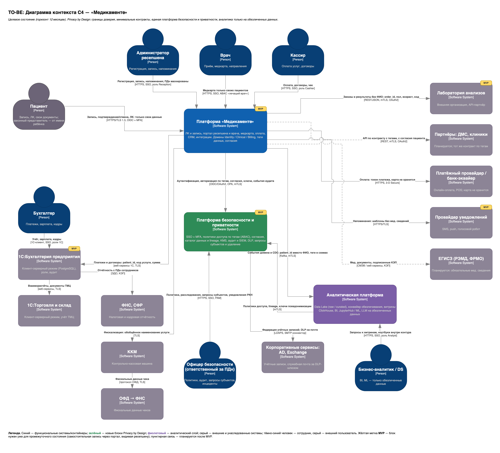
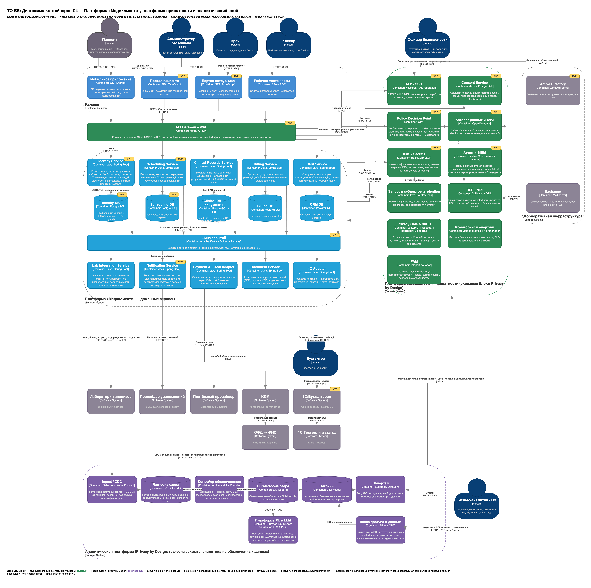

# Задание 2. Проектирование решения по принципам Privacy by Design

## Состав

| Файл | Содержание |
|---|---|
| `Medikamente_C4_context_to-be.drawio` / `-1-context.png` | **Диаграмма контекста C4 целевого состояния** (уровень 1): платформа «Медикаменте», платформа безопасности и приватности, аналитическая платформа, люди, унаследованные и внешние системы |
| `Medikamente_C4_container_to-be.drawio` / `-1-container.png` | Диаграмма контейнеров (уровень 2): новые блоки Privacy by Design, доменные сервисы, аналитический слой и их связи |
| этот `README.md` | обоснование: принципы → механизмы, каталог новых блоков, аналитический слой, покрытие рисков из Задания 1 |

Цветовой код на диаграммах: синий — функциональные контейнеры, **зелёный — новые блоки Privacy by Design**,
**фиолетовый — аналитический слой**, серый — внешние и унаследованные системы. Метка **MVP** — блок нужен уже
для промежуточного состояния (пациент записывается через портал, ресепшен видит запись и напоминает за день).

## 1. Исходная точка

Задание 1 показало: все данные «Медикаменте» лежат в файлах на общем диске за одной доменной учётной
записью, без аудита, классификации, шифрования и контроля каналов (R-01…R-20). Целевая система по
описанию кейса должна дать портал пациента и ресепшена, платёжный шлюз, CRM, интеграцию с лабораторией,
озеро данных для BI/ML/LLM и при этом соответствовать 152-ФЗ и врачебной тайне. Privacy by Design
означает, что защита данных проектируется как свойство архитектуры, а не добавляется настройками после
внедрения.

## 2. Принципы Privacy by Design → архитектурные решения

| Принцип (Cavoukian) | Как реализован в целевой архитектуре | Блоки на диаграмме |
|---|---|---|
| **1. Проактивность, а не реакция** | риски из Задания 1 закрываются до написания кода: Privacy Gate в CI блокирует релиз, если контракт или схема возвращают данные с запрещённым тегом; модель угроз и теги — вход для проектирования каждого сервиса | Privacy Gate в CI/CD, Каталог данных |
| **2. Приватность по умолчанию** | новый пациент получает минимальный профиль; расширенная анкета, маркетинговые коммуникации, передача партнёрам — только после явного согласия, зафиксированного в Consent Service; API Gateway по умолчанию режет поля с тегами `pii.*` для внешних клиентов | Consent Service, API Gateway, PDP |
| **3. Встроенность в дизайн** | разделение доменов: прямые идентификаторы живут только в Identity Service, остальные домены работают с `patient_id`; шина событий переносит только псевдонимизированные события; шифрование — свойство хранилищ, а не опция | Identity Service, Kafka с тегами в схемах, KMS |
| **4. Полная функциональность (без ложных компромиссов)** | врач видит полную карту своих пациентов, аналитик получает витрины и ноутбуки, пациент — свои документы в ЛК; ограничения реализованы политиками, а не отключением функций | PDP (ABAC), Шлюз доступа к данным, Портал пациента |
| **5. Сквозная защита на всём жизненном цикле** | сбор (минимальная анкета) → хранение (шифрование, теги) → использование (RBAC/ABAC, маскирование) → передача (mTLS, контракты) → аналитика (обезличивание) → удаление (retention по тегам, crypto-shredding) | KMS, Каталог, Запросы субъектов и retention |
| **6. Прозрачность и подотчётность** | каждое обращение к тегированным данным пишется в неизменяемый журнал; lineage показывает, где находятся копии; пациент в ЛК видит, кто и когда открывал его карту; офицер безопасности отвечает на запросы субъектов из одной консоли | Аудит и SIEM, Каталог (lineage), Мониторинг |
| **7. Уважение к пользователю** | пациент сам подтверждает и отменяет запись, управляет согласиями и каналами уведомлений, получает документы по защищённой ссылке; верификация кодовым словом/OTP защищает его от выдачи данных третьему лицу | Портал пациента, Мобильное приложение, Notification Service |

Дополнительно применены **Data Minimization** (контракт лаборатории без ФИО, обобщённое наименование
услуги в чеке, агрегаты вместо строк в отчётах) и **Data Lineage** (каталог фиксирует путь источник →
Kafka → raw → curated → витрина → отчёт; теги наследуются по lineage, пока конвейер не поставит
`anonymized=true`).

## 3. Новые блоки Privacy by Design (контейнеры зелёного цвета)

Эти блоки сквозные: ими пользуется каждый доменный сервис, канал и аналитический компонент, поэтому
любая новая интеграция получает защиту «по умолчанию» и не требует повторной валидации.

| Блок | Технология | Что делает | Кого обслуживает | Закрывает риски |
|---|---|---|---|---|
| **API Gateway + WAF** | Kong / APISIX | единая точка входа: OAuth2/OIDC для пользователей, mTLS + client credentials для партнёров, схемная валидация запросов и ответов, rate limit, фильтрация полей ответа по тегам, журнал запросов | все каналы, лаборатория, партнёры | R-14, R-05 |
| **IAM / SSO** | Keycloak с федерацией в AD | OIDC/OAuth2, MFA для всех сотрудников, роли и атрибуты (отделение, список пациентов врача) в токене, единый logout, интеграция с PAM | все пользователи и сервисы | R-01, R-12 |
| **Policy Decision Point** | OPA | ABAC-политики «роль + атрибуты субъекта + теги данных + контекст (время, место)»; один и тот же движок отвечает API Gateway, BI и шлюзу доступа к данным | API Gateway, сервисы, аналитика | R-01, R-06 |
| **Consent Service** | Java + PostgreSQL | согласия по целям и категориям (мед. обработка, коммуникации, передача партнёрам), версии текстов, отзыв; сервисы проверяют согласие до обработки; история согласий — доказательство для РКН | Identity, CRM, Notification, партнёрские API | R-03, R-10 |
| **Каталог данных и теги** | OpenMetadata | таксономия `pii.basic / contact / id / med / employee`, `fin`, атрибуты retention и legal_basis; автообнаружение ПДн; lineage из Kafka, Airflow, ClickHouse; источник истины для политик, CI и retention | PDP, CI, DSAR, аналитика | R-11, R-06 |
| **KMS / Secrets** | HashiCorp Vault | ключи шифрования колонок и документов, per-patient DEK (для crypto-shredding), ключи псевдонимизации для конвейера, ротация; администратор инфраструктуры не владеет ключами данных | все хранилища, конвейер обезличивания | R-08, R-12 |
| **Аудит и SIEM** | Elastic / OpenSearch + правила | неизменяемый журнал «кто, что, когда, по какой роли» для каждого обращения к тегированным данным; корреляция, UEBA-правила (массовое чтение, доступ вне смены, чужие пациенты), алерты, трек уведомления РКН за 24/72 ч | сервисы, шлюз, БД (pgaudit), Kubernetes | R-02 |
| **Запросы субъектов и retention** | Java + Airflow jobs | приём запросов субъекта (доступ, исправление, ограничение, удаление), поиск всех копий по lineage, исполнение с подтверждением; автоматические сроки хранения по тегам | офицер безопасности, пациент через ЛК | R-10, R-07 |
| **DLP + VDI** | DLP-шлюз, VDI | блокировка отправки restricted-данных по почте и на USB, учёт печати, рабочие места врачей и аналитиков без локальных копий | Exchange, рабочие станции | R-07, R-20, R-05 |
| **Privacy Gate в CI/CD** | GitLab CI + Spectral + контрактные тесты | линтер схем и OpenAPI на теги, тест «внешний эндпоинт не отдаёт запрещённые теги», BOLA-тесты (пациент A не видит B), SAST/DAST; результат — в мониторинг | все команды разработки | R-14, R-11 |
| **Мониторинг и алертинг** | Victoria Metrics + Alertmanager | метрики приватности (доля запросов с раскрытием, отказы PDP, просроченные DSAR), SLO, дежурная смена | CTO, офицер безопасности | R-02 |
| **PAM** | Teleport или аналог | привилегированный доступ по заявке (JIT), запись сессий, разделение обязанностей администратора и владельца данных | администратор сети | R-12 |

Доменные сервисы (синие) спроектированы так, чтобы блоки выше работали автоматически:

* **Identity Service** — единственный владелец ФИО, паспорта и контактов; выдаёт `patient_id`;
  в Identity DB колоночное шифрование, HMAC-индексы для поиска по телефону без хранения открытого
  значения, RLS и pgaudit.
* **Scheduling Service** — расписание хранит `patient_id`, врача, время и код услуги; повод обращения
  уходит в Clinical. Ресепшен видит маскированные ФИО и телефон, «раскрыть» — отдельное журналируемое
  действие.
* **Clinical Records Service** — медкарта без прямых идентификаторов, документы в S3 с SSE-KMS и
  тегом `pii.med`; доступ по ABAC «лечащий или направивший врач»; результаты анализов привязаны к `order_id`.
* **Billing Service** и **Payment & Fiscal Adapter** — платежи по `patient_id`, карта не касается
  системы (токен провайдера), в чек ОФД уходит обобщённое наименование услуги.
* **CRM Service** и **Notification Service** — коммуникации только при согласии, шаблоны без мед.
  сведений, подтверждение/отмена записи из push или голосового робота.
* **Lab Integration Service** — контракт с лабораторией: `order_id`, пол, возраст, код исследования;
  результаты проверяются по схеме и подписи.
* **Document Service** — договоры и заключения с КЭП, водяными знаками и учётом печати/выдачи.
* **Шина событий (Kafka)** — события с `patient_id`, теги в схемах Avro, ACL на топики с `pii.med`,
  mTLS; единственный путь данных в аналитический слой.

## 4. Аналитический слой с Privacy by Design (контейнеры фиолетового цвета)

Принцип слоя: **аналитик никогда не видит сырых данных**, а конвейер обезличивания — единственный
потребитель raw-зоны.

```
Kafka (patient_id, теги) ──► Ingest / CDC ──► Raw-зона (S3, SSE-KMS, доступ только конвейеру)
                                                       │
                                     Конвейер обезличивания (Airflow + dbt + Presidio):
                                     псевдонимизация → обобщение → k-анонимность ≥ 5,
                                     l-разнообразие диагнозов → тег anonymized=true
                                                       │
                     ┌─────────────────────────────────┼──────────────────────┐
                     ▼                                 ▼                      ▼
            Curated-зона (Iceberg)            Витрины ClickHouse       Платформа ML и LLM
            обезличенные наборы               агрегаты, row policies    JupyterHub, MLflow,
                     │                                 │                локальная LLM (RAG)
                     └────────► Шлюз доступа к данным (Trino + OPA) ◄──┘
                                политики по тегам, маскирование на лету, журнал запросов
                                               │
                                         BI-портал, аналитик
```

| Компонент | Технология | Privacy-свойство |
|---|---|---|
| Ingest / CDC | Debezium, Kafka Connect | получает только события и CDC с `patient_id`; прямые идентификаторы в озеро не попадают, Identity DB в CDC не включена |
| Raw-зона | S3 с SSE-KMS | псевдонимизированные сырые данные; ACL — только сервисная учётная запись конвейера; retention по тегам; теги наследуются из каталога |
| Конвейер обезличивания | Airflow + dbt + Presidio | методы приказа РКН № 996 и k-анонимность; текстовые поля (заключения) проходят NER-маскирование; результат получает тег `anonymized=true`, без которого данные недоступны роли Analyst |
| Curated-зона | S3 / Apache Iceberg | обезличенные наборы для BI, обучения ML и RAG для LLM; версии и time travel для воспроизводимости |
| Витрины | ClickHouse | агрегаты и обезличенные детальные таблицы; row policies по роли; без ФИО и точных дат |
| Шлюз доступа к данным | Trino + OPA | единая точка SQL-доступа: решения PDP по тегам, динамическое маскирование, журнал запросов в SIEM, лимиты на выгрузку |
| BI-портал | Superset / DataLens | отчёты P&L, ABC, загрузка врачей; доступ по роли, экспорт только агрегатов |
| Платформа ML и LLM | JupyterHub, MLflow, локальная LLM | ноутбуки и модели внутри контура, без выгрузки на устройство; обучение и RAG только на curated-зоне; промпты и ответы LLM журналируются и проверяются DLP-правилами |

Lineage в каталоге связывает каждую витрину и отчёт с источником, поэтому при запросе субъекта на
удаление конвейер пересобирает затронутые наборы, а при аудите можно доказать, что в отчёт попали только
обезличенные данные. Этим слой отвечает бизнес-цели 2 (BI/ML/AI) без расширения круга лиц с доступом к
врачебной тайне.

## 5. Домены данных и доступ к ним (кратко)

| Домен | Данные (теги) | Хранилище | Кто имеет доступ (RBAC / ABAC) |
|---|---|---|---|
| Identity | ФИО, ДР, паспорт, контакты (`pii.basic/contact/id`) | Identity DB (шифрование колонок) | Reception — маскировано, полностью при оформлении договора; Cashier — ФИО и № договора; Doctor — ФИО своих пациентов; остальные — нет |
| Clinical | диагнозы, анамнез, заключения, анализы (`pii.med`) | Clinical DB + S3 | Doctor — ABAC «лечащий/направивший»; Chief doctor — всё; пациент — своё через ЛК; Reception, Cashier, Analyst — нет |
| Scheduling | записи, время, код услуги (`pii.basic` через ссылку) | Scheduling DB | Reception — все записи с маской; Doctor — своё расписание; пациент — свои записи |
| Billing | платежи, договоры (`fin`) | Billing DB, 1С | Cashier, Accountant; пациент — свои |
| CRM | согласия на коммуникации, история (`pii.contact`) | CRM DB | Reception, маркетинг — только при согласии |
| HR | данные сотрудников (`pii.employee`) | 1С, защищённое хранилище сканов | Accountant/HR |
| Analytics | обезличенные наборы (`anonymized=true`) | curated, ClickHouse | Analyst, руководство через BI |

Полная ролевая модель и атрибуты — предмет отдельного задания; здесь зафиксировано распределение
категорий по доменам, на которое опираются PDP и каталог.

## 6. Промежуточное состояние (MVP) и целевое

| | MVP (через пару месяцев) | Целевое (через год) |
|---|---|---|
| Каналы | портал пациента, портал сотрудника | + мобильное приложение, голосовой робот |
| Доменные сервисы | Identity, Scheduling, Notification, Kafka | + Clinical, Billing, CRM, Lab Integration, Document, 1С Adapter |
| Privacy-блоки | API Gateway, IAM/SSO + MFA, PDP, Consent, Каталог и теги, KMS, Аудит и SIEM | + DSAR/retention, DLP + VDI, Privacy Gate в CI, PAM, мониторинг приватности |
| Аналитика | — (данные ещё в Excel; подготовка каталога) | полный слой: raw/curated, конвейер обезличивания, витрины, BI, ML/LLM, шлюз доступа |
| Интеграции | 1С клиент-сервер, провайдер уведомлений | лаборатория по API, платёжный провайдер, партнёры, ЕГИСЗ |

## 7. Покрытие проблемных зон Задания 1

| R | Блоки целевой архитектуры |
|---|---|
| R-01, R-06 | Identity/Clinical разделение, PDP, IAM, каталог |
| R-02 | Аудит и SIEM, мониторинг, pgaudit в БД |
| R-03 | Consent Service, минимальная анкета в Identity, контракты без ПДн |
| R-04 | Document Service (сканирование и учёт), регламент бумаги |
| R-05 | API Gateway (mTLS), DLP на Exchange, Notification без мед. сведений |
| R-07, R-20 | DLP + VDI, запрет выгрузок в аналитике, шлюз доступа к данным |
| R-08 | KMS, шифрование колонок и S3 SSE-KMS, шифрованные бэкапы |
| R-09, R-13 | Billing Service вместо Excel, 1С клиент-сервер, 1С Adapter |
| R-10 | Запросы субъектов и retention, crypto-shredding через KMS |
| R-11 | Каталог данных, lineage, теги в Kafka-схемах |
| R-12, R-18 | IAM + MFA, PAM, сегментация (Kubernetes NetworkPolicy, отдельный контур ИСПДн) |
| R-14 | API Gateway, Lab Integration с контрактом, Privacy Gate в CI |
| R-15 | аналитический слой целиком |
| R-16 | верификация в Notification/портале, документы через ЛК |
| R-17 | офицер безопасности как роль, Consent Service и аудит как доказательная база |
| R-19 | 1С клиент-сервер, HR-домен с ролями |

## 8. Допущения

* Платформа разворачивается в Kubernetes в аттестуемом сегменте на территории РФ (вторая площадка
  или российское облако); выбор площадки и сетевая схема — за рамками уровней C4 1–2.
* 1С:Бухгалтерия, 1С:Торговля и склад, ККМ, AD и Exchange сохраняются как унаследованные системы;
  1С переводится в клиент-серверный режим, интеграция — через 1С Adapter, а не файловый обмен.
* Партнёрские API, ЕГИСЗ и мобильное приложение показаны как блоки после MVP; они используют те же
  gateway, PDP и каталог, поэтому не требуют отдельной валидации модели приватности.
* Конкретные продукты (Keycloak, OPA, OpenMetadata, Vault, Elastic, ClickHouse, Trino, Superset)
  выбраны под стек IT-отдела; там, где закон требует сертифицированных средств (СКЗИ, DLP, МЭ),
  подразумеваются решения из реестра ФСТЭК/ФСБ.

## Как перегенерировать диаграммы

```bash
python3 tools/diagram/gen_c4.py Task2
python3 tools/diagram/render.py Task2/*.drawio
```

## Диаграммы

### Контекст (C4, уровень 1)



### Контейнеры (C4, уровень 2)


