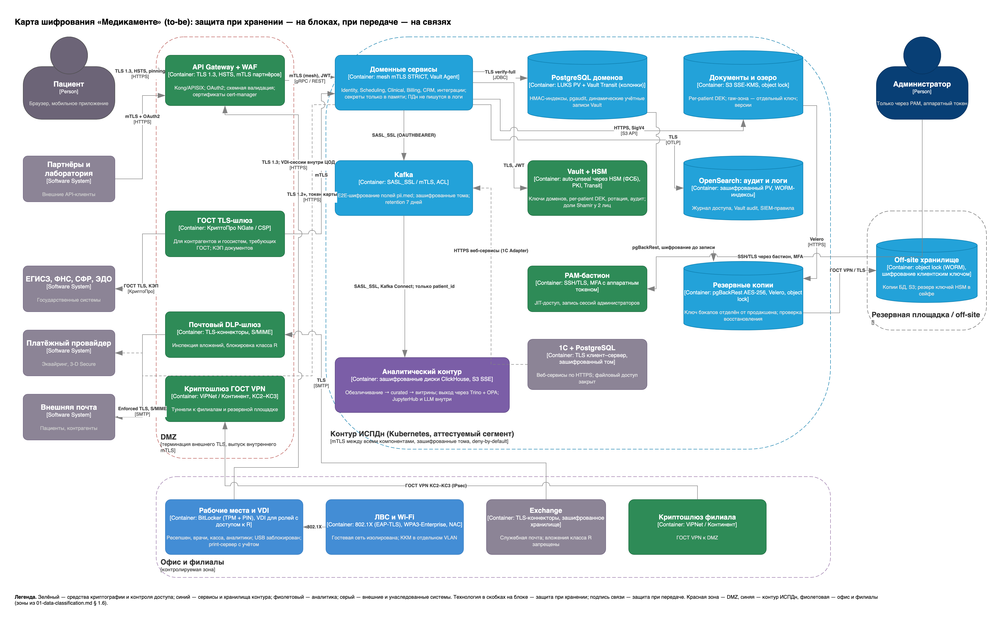

# Задание 3. Стратегия защиты данных: шифрование при хранении и при передаче

## Состав

| Файл | Содержание |
|---|---|
| `01-data-classification.md` | классификация данных: четыре класса чувствительности × три состояния × профиль риска; матрица требуемого уровня защиты; реестр данных в формате примера задания (данные → необходимость защиты → инструменты) |
| `02-protection-tools.md` | базовые инструменты: управление ключами (HSM + Vault, иерархия ключей, ротация, ГОСТ), шифрование при хранении (том → поле/объект → бэкап), при передаче (все каналы), при обработке |
| `03-automated-controls.md` | автоматизированный контроль: политики как код на admission и в CI, сканирование TLS и конфигураций, контроль ключей и сертификатов, обнаружение ПДн вне разрешённых мест, метрики и алерты |
| `04-registry.md` | реестр программных (S-01…S-26) и аппаратных (H-01…H-12) средств защиты с назначением, классами данных, местом в архитектуре, требованиями к сертификации, владельцем и этапом |
| `Medikamente_encryption_map.drawio` / `-1-encryption-map.png` | карта шифрования: зоны доверия целевой архитектуры, защита при хранении на блоках, защита при передаче на связях |

## Кратко: четыре результата задания

### 1. Какие данные защищаем

| Класс | Содержание | Риск | Минимум защиты |
|---|---|---|---|
| **R — Restricted** | сведения о здоровье (врачебная тайна), паспорт/СНИЛС/ИНН, ключи и секреты, журналы аудита, учётные данные администраторов | критический: необратимый ущерб субъекту, приостановка обработки, оборотные штрафы | шифрование тома **и** поля/объекта с per-patient ключами из HSM-backed KMS; TLS 1.3 / mTLS / ГОСТ VPN; маскирование, VDI, запрет в логах |
| **C — Confidential** | ФИО, контакты, платежи, договоры, согласия, ПДн сотрудников, расписание | высокий | шифрование тома, поля — для контактов и реквизитов; TLS 1.2+ / mTLS; маскирование в UI |
| **I — Internal** | обезличенные витрины, прайс, закупки, конфигурации, код | средний | шифрование тома, TLS |
| **P — Public** | публичный прайс, список врачей, контент сайта | низкий | целостность: TLS, подпись релизов |

Состояния: **при хранении** (БД доменов, S3, Kafka, озеро, ClickHouse, OpenSearch, 1С, бэкапы, рабочие
станции, бумага), **при передаче** (пациент, партнёры, госсистемы, внутренние вызовы, межсайтовые каналы,
почта, администрирование) и **при обработке** (память, экран, ноутбуки, Jupyter, LLM, печать).

### 2. Базовые инструменты защиты

| Слой | Инструменты |
|---|---|
| Ключи | **HSM** (КриптоПро/Рутокен HSM) как корень доверия → **HashiCorp Vault** (Transit, PKI, динамические учётные записи) → ключи доменов → per-patient DEK; ротация; разделение обязанностей; **КриптоПро CSP** и **ViPNet/Континент** там, где требуется ГОСТ |
| При хранении | LUKS/зашифрованные PV на всех узлах; колоночное шифрование `pii.id`/`pii.contact` через Vault Transit и HMAC-индексы в PostgreSQL; S3 SSE-KMS с object lock для документов и озера; e2e-шифрование полей `pii.med` в Kafka; зашифрованные диски ClickHouse; WORM-индексы аудита; pgBackRest/Velero с отдельным ключом и off-site копией; BitLocker/VDI на рабочих местах |
| При передаче | TLS 1.3 + HSTS + pinning снаружи; mTLS (service mesh) внутри; `verify-full` к БД, SASL_SSL к Kafka; mTLS + OAuth2 для партнёров; ГОСТ TLS и КЭП для госсистем; ГОСТ VPN класса КС2–КС3 между площадками; TLS + S/MIME + DLP для почты; 802.1X/WPA3-Enterprise в офисе; PAM для администраторов |
| При обработке | маскирование по умолчанию с журналируемым «раскрыть», фильтры ПДн в логах, секреты только в памяти, VDI, print-сервер с учётом, локальная LLM с DLP-проверкой промптов |

### 3. Автоматизированный контроль

* **Превентивно:** Kyverno/OPA Gatekeeper запрещают незашифрованные PV, Ingress без TLS, mesh без STRICT, `PLAINTEXT` Kafka; gitleaks, checkov, Trivy, Spectral и линтер миграций блокируют merge при секретах в коде, небезопасной IaC и полях без тегов/шифрования.
* **Детективно:** testssl/sslyze по инвентарю эндпоинтов, экспорт сроков сертификатов, Vault audit → SIEM с UEBA-правилами на аномальные `decrypt`, проверка фактического шифрования дисков и сессий PostgreSQL без SSL, Presidio/OpenMetadata ищут ПДн в логах и озере, Suricata ловит открытые протоколы, ежедневная проверка и еженедельное тестовое восстановление бэкапов.
* **Метрики:** 100 % зашифрованных томов, 100 % эндпоинтов с оценкой «A», 0 сертификатов < 14 дней, 0 просроченных ротаций, 0 находок ПДн вне разрешённых хранилищ — на дашборде Victoria Metrics с алертами в Alertmanager и SIEM.

### 4. Реестр средств

26 программных и 12 аппаратных позиций в `04-registry.md`. Сертифицированными закупаются средства, которых
требуют ФСБ 378 и ФСТЭК 21 при УЗ-1/УЗ-2: HSM, криптошлюзы ГОСТ VPN, КриптоПро CSP/NGate, межсетевые экраны,
DLP, антивирус/EDR, при аттестации — PAM и СЗИ от НСД. Внутри аттестованного контура используется open source
под стек IT-отдела: Vault, cert-manager, service mesh, PostgreSQL + pgaudit + Vault Transit, MinIO + KES,
Kafka TLS, OpenSearch, Kyverno, Trivy, OpenMetadata, Presidio.

## Карта шифрования



## Связь с предыдущими заданиями

* Классы R/C/I/P опираются на теги `pii.*`, `fin`, `biz` из `Task1/04-data-tagging.md`; реестр данных
  расширяет `Task1/03-data-protection.md` сроками и инструментами.
* Блоки Vault + HSM, PAM, DLP, Privacy Gate, SIEM и аналитический контур — из целевой архитектуры
  `Task2`; карта шифрования показывает те же контейнеры в разрезе зон доверия.
* Меры соответствуют C-02 (at rest), C-03 (in transit), C-08, C-12, C-13, C-18 и C-19 из `Task1/05-controls.md`.

## Допущения

* Уровень защищённости ИСПДн принят как УЗ-2 (спец. категории, менее 100 тыс. субъектов) с переходом к
  УЗ-1 при превышении порога; окончательный класс СКЗИ (КС2/КС3) определяет модель угроз.
* Внутри контролируемой зоны допускается несертифицированная криптография (TLS 1.3, AES-GCM) при наличии
  аттестованного периметра и организационных мер; все внешние каналы ПДн — на сертифицированных СКЗИ.
* Конкретные продукты указаны как ориентир под стек компании; при закупке проверяется актуальность
  сертификатов в реестрах ФСТЭК и ФСБ.

## Как перегенерировать карту

```bash
python3 tools/diagram/gen_encryption_map.py Task3
python3 tools/diagram/render.py Task3/Medikamente_encryption_map.drawio
```
