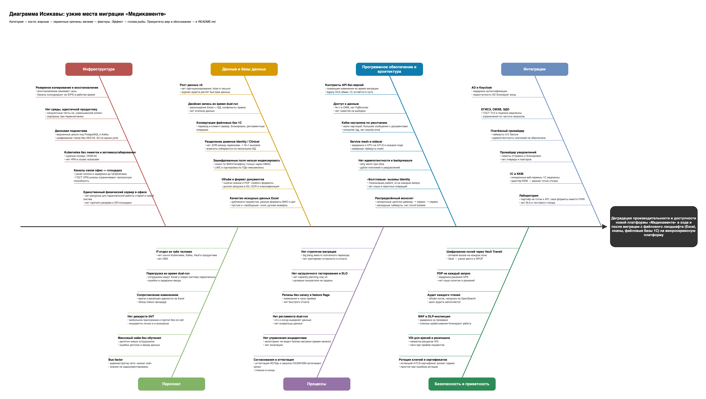

# Задание 4. Оценка узких мест при миграции

## Состав

| Файл | Содержание |
|---|---|
| `Medikamente_migration_ishikawa.drawio` / `-1-ishikawa.png` | диаграмма Исикавы: 7 категорий, 44 первичные причины с факторами |
| этот `README.md` | отчёт: анализ ситуации, разбор причин по категориям, рекомендации с приоритетами, план контроля |

## 1. Анализ ситуации

### 1.1. Откуда и куда мигрируем

| | As-Is (Task 1) | To-Be (Task 2, 3) |
|---|---|---|
| Хранение данных | Excel-файлы, сканы и PDF на общем диске; файловые базы 1С | PostgreSQL по доменам (Identity, Scheduling, Clinical, Billing, CRM), S3 для документов, Kafka, озеро данных и ClickHouse |
| Бизнес-логика | в головах сотрудников и формулах Excel; 1С-конфигурации | микросервисы на Java за API Gateway; политики доступа в OPA; согласия, теги, аудит как сквозные сервисы |
| Инфраструктура | один физический сервер Windows в офисе: AD, файлы, почта, 1С, ККМ по OLE | Kubernetes в аттестуемом сегменте (вторая площадка / облако РФ), HSM + Vault, ГОСТ VPN к филиалам, DMZ |
| Интеграции | ручные: e-mail, бумага, OLE | API-контракты: лаборатория, платёжный провайдер, уведомления, 1С по веб-сервисам, ЕГИСЗ |
| Безопасность | доменная учётная запись | mTLS, шифрование полей, PDP на каждый запрос, аудит каждого чтения, DLP, VDI |
| Пользователи | 35 сотрудников в одном офисе | ×5 данных, филиалы, десятки новых сотрудников, пациенты в портале и мобильном приложении |

Формально «монолита» в компании нет, но файловый ландшафт ведёт себя как монолит худшего рода: единое
хранилище без границ, единый сервер, единый администратор. Миграция одновременно меняет **модель данных**
(файлы → нормализованные домены), **модель исполнения** (ручная → сервисы), **модель доступа** (все видят
всё → ABAC) и **площадку** (офис → ЦОД). Именно совмещение четырёх переходов и порождает узкие места.

### 1.2. Допущения о масштабе (горизонт 12 месяцев)

| Параметр | Оценка | Следствие для производительности |
|---|---|---|
| Пациентов в базе | 20 тыс. сейчас → 100 тыс. | объём ПДн переходит порог УЗ-1; HMAC-индексы и шифрование полей на всех записях |
| Специалистов / филиалов | 15 / 1 → 75 / 4–5 | ~1 500 приёмов в день, пики записи утром и в начале месяца; трафик межфилиальный через ГОСТ VPN |
| Документы | ~0,2 ТБ сканов и PDF → ~1 ТБ | первичная загрузка в S3 с OCR и классификацией — недели, если делать в одном потоке |
| Запросов к API в пике | единицы–десятки RPS от сотрудников, сотни RPS от портала/приложения в акциях и рассылках | нагрузка невелика по меркам веба: узкие места будут **структурными** (цепочки вызовов, шифрование, аудит), а не «железными» |
| Событий аудита | каждое чтение тегированных данных → 1–3 млн записей в день | OpenSearch и диски под аудит растут быстрее основных данных |
| Сообщений в Kafka | десятки тысяч в день, но с вложениями до мегабайт, если класть документы в события | большие сообщения ломают latency брокеров |

### 1.3. Ключевые процессы и компоненты, затрагиваемые миграцией

| Процесс (DFD из Task 1) | Что меняется | Компоненты под риском | Почему это узкое место |
|---|---|---|---|
| 1. Регистрация пациента | Excel + папки → Identity Service, Consent, S3 | Identity DB (шифрование полей, HMAC-поиск), Vault Transit | поиск дубликатов и ввод нового пациента становятся дороже: каждый поиск — HMAC, каждое поле — вызов KMS |
| 2. Запись на приём | журналы врачей → Scheduling + портал + уведомления | Scheduling DB, Notification, провайдер SMS/push, PDP | самый массовый пользовательский сценарий; любая задержка видна пациенту и ресепшену |
| 3. Приём врача | папка пациента → Clinical Records + S3 + VDI | Clinical DB, S3, VDI, аудит | врач ждёт открытия карты на приёме: 2–3 секунды задержки × 20 пациентов в день = заметная потеря времени |
| 4. Анализы | e-mail/бумага → Lab Integration API | API Gateway, партнёрский шлюз, Kafka | зависимость от готовности внешнего партнёра и его SLA |
| 5. Оплата | Excel + ККМ по OLE → Billing + Payment Adapter + 1С веб-сервисы | адаптер ККМ, 1С, платёжный провайдер | синхронные внешние вызовы в момент оплаты на кассе |
| 6. Бухгалтерия, кадры | файловая 1С → клиент-сервер на PostgreSQL | сервер 1С, PostgreSQL, бэкапы | конвертация базы и регламентные операции блокируют работу бухгалтерии |
| 7. Аналитика | локальные Excel → Kafka → озеро → ClickHouse | CDC, конвейер обезличивания, ClickHouse | первичная историческая загрузка и k-анонимизация текстов (Presidio) ресурсоёмки |
| 8. Почта, диск, вывод | общий диск → сервисы; почта за DLP; VDI | DLP, VDI, ГОСТ VPN | инспекция и терминальный доступ добавляют задержку на каждое действие сотрудника |
| Сквозные | — | IAM, PDP, Vault, аудит, service mesh, Kafka | каждый из них на пути **каждого** запроса; деградация любого = деградация всего |

### 1.4. Подход к миграции, относительно которого оцениваются узкие места

Поэтапный переход по процессам (strangler fig) с периодом параллельной работы (dual-run):

1. **Фундамент:** площадка, Kubernetes, IAM, Vault/HSM, каталог и теги, наблюдаемость; 1С переводится в
   клиент-серверный режим; исторические данные загружаются и выверяются.
2. **MVP:** Identity + Scheduling + портал пациента и сотрудника + уведомления; Excel-журналы остаются
   только для чтения, запись — в новой системе.
3. **Клинический контур:** Clinical Records, документы, лаборатория по API, VDI для врачей.
4. **Деньги и интеграции:** Billing, платёжный провайдер, ККМ, 1С-адаптер; вывод `Payments.xlsx`.
5. **Аналитика и расширение:** озеро, витрины, BI/ML; мобильное приложение; филиалы; партнёры, ЕГИСЗ.

Каждый этап имеет критерии готовности (SLO, выверка данных), окно переключения и план отката.
Узкие места ниже привязаны к этим этапам.

## 2. Диаграмма Исикавы

Эффект (голова рыбы): **деградация производительности и доступности новой платформы в ходе и после
миграции**. Категории: Инфраструктура, Данные и базы данных, Программное обеспечение и архитектура,
Интеграции, Персонал, Процессы, Безопасность и приватность. Последние две категории добавлены к примеру из
задания, потому что в этом кейсе миграция данных — основная работа, а меры Privacy by Design и шифрование
из Task 2–3 сами по себе являются источником задержек, если спроектированы без учёта нагрузки.

## 3. Разбор причин по категориям

Для каждой причины: механизм, через который она превращается в узкое место, наблюдаемый симптом и метрика,
по которой его ловить, этап миграции, где риск максимален.

### 3.1. Инфраструктура

| Причина | Механизм узкого места | Симптом / метрика | Этап |
|---|---|---|---|
| Единственный физический сервер в офисе | на время dual-run старая система (файлы, 1С, почта) и новая (Kubernetes) делят CPU, RAM, IOPS; нет места для стендов | рост latency Excel-доступа и 1С одновременно с новой системой; `iowait`, очереди дисков | 1–2 |
| Каналы связи офис ↔ площадка | весь трафик сотрудников к ЦОД идёт через ГОСТ VPN-шлюз; типичный шлюз КС3 даёт сотни Мбит/с и ограничен по числу сессий; задержка 10–30 мс на каждый вызов умножается на «болтливые» API | медленный интерфейс у ресепшена в пик, VDI-лаги; RTT, утилизация шлюза, потери | 2–5 |
| Kubernetes без лимитов и автомасштабирования | pod без `requests/limits` вытесняет соседей; нет HPA — пики записи упираются в число реплик; нет cluster autoscaler — узлы заканчиваются | OOM-kill, `CPU throttling`, p99 latency в пик утренней записи | 2 |
| Дисковая подсистема | PostgreSQL с шифрованным томом и WAL на одних дисках с Kafka и OpenSearch; без AES-NI шифрование тома съедает CPU | `fsync` latency, Kafka ISR shrink, рост `commit` времени | 1–3 |
| Нет среды, идентичной продуктиву | нагрузочное тестирование на уменьшенной копии не показывает проблемы шифрования, mesh и VPN | «в тесте работало» при переключении | 2 |
| Резервное копирование и восстановление | полные бэкапы в рабочее время конкурируют за IOPS; восстановление ТБ документов занимает часы | деградация в окно бэкапа; RTO > целевого | все |

### 3.2. Данные и базы данных

| Причина | Механизм | Симптом / метрика | Этап |
|---|---|---|---|
| Качество исходных данных Excel | один пациент в нескольких строках с разным написанием ФИО и дат; сопоставление требует нечёткого поиска и ручной выверки; миграция растягивается, dual-run удлиняется | доля дублей после загрузки, объём ручной выверки | 1–2 |
| Объём и формат документов | ~1 ТБ файлов «любого формата»: загрузка, вирус-проверка, OCR, классификация по тегам, привязка к пациенту; в один поток — недели | длительность первичной загрузки, очередь OCR | 1, 3 |
| Зашифрованные поля нельзя индексировать | поиск по телефону/ФИО только по точному HMAC; `LIKE`, сортировка и «похожие» запросы по ПДн невозможны; ресепшен ищет пациента медленнее, чем в Excel с Ctrl+F | время поиска пациента, число «не нашёл — создал дубль» | 2 |
| Разделение доменов Identity / Clinical | нельзя сделать JOIN «ФИО + диагноз»; списки (расписание на день с именами) собираются N+1 вызовами в Identity | latency экранов-списков, RPS на Identity | 2–3 |
| Конвертация файловых баз 1С | перевод в клиент-сервер: длительная конвертация, пересчёт итогов, блокировки; регламентные операции на PostgreSQL без тюнинга | простой бухгалтерии в окно конвертации, медленные отчёты | 1 |
| Двойная запись во время dual-run | ресепшен вносит запись и в журнал Excel, и в систему; расхождения накапливаются, нет эталона | число расхождений при выверке, жалобы на «пропавшие» записи | 2–4 |
| Рост данных ×5 | без партиционирования таблиц записей, событий и аудита — bloat, долгий vacuum, медленные индексы | размер таблиц, `dead tuples`, autovacuum lag | 4–5 |

### 3.3. Программное обеспечение и архитектура

| Причина | Механизм | Симптом / метрика | Этап |
|---|---|---|---|
| Распределённый монолит | сценарий «записать пациента» синхронно проходит gateway → Scheduling → Identity → Consent → Notification; таймаут любого звена = ошибка пользователю; без circuit breaker сбой лавинообразно растёт | p99 latency записи, доля ошибок 5xx при сбое одного сервиса | 2 |
| «Болтливые» вызовы Identity | каждый экран дереференсит `patient_id` → ФИО отдельными вызовами; токенизация при каждом сохранении | RPS Identity в разы выше бизнес-операций | 2–3 |
| Нет идемпотентности и backpressure | повтор запроса создаёт вторую запись/платёж/SMS; при сбое клиенты ретраят и добивают сервис | дубли платежей и уведомлений, retry storm | 2, 4 |
| Service mesh и sidecar | mTLS и прокси в каждом поде добавляют 1–3 мс и CPU на hop; при 5 hop в цепочке — заметно; неверные таймауты mesh обрывают длинные операции (загрузка документов) | latency по hop, CPU sidecar, обрывы загрузок | 2–3 |
| Kafka настроена по умолчанию | мало партиций → один consumer; документы внутри событий → большие сообщения; нет exactly-once → дубли в озере | consumer lag, размер сообщений, дубли в витринах | 3–5 |
| Доступ к данным | N+1 в ORM, отсутствие PgBouncer: сотни коротких соединений с TLS-рукопожатием | число соединений PostgreSQL, время рукопожатий | 2 |
| Контракты API без версий | изменение схемы ломает портал/мобильное приложение/партнёра в середине миграции; OLE-обмен 1С остаётся как «временное» решение | инциденты после релизов, доля клиентов на старых версиях | 2–5 |

### 3.4. Интеграции

| Причина | Механизм | Симптом / метрика | Этап |
|---|---|---|---|
| Лаборатория | партнёр присылает PDF и не готов к API; формат не FHIR; нет тестового стенда и SLA — интеграция отстаёт, ручной обмен сохраняется | доля заказов через API, время получения результата | 3 |
| 1С и ККМ | синхронный вызов веб-сервиса 1С при оплате; адаптер ККМ в одном экземпляре; OLE-наследие | время оплаты на кассе, ошибки фискализации | 4 |
| Провайдер уведомлений | лимиты отправки, блокировки за «спам», отсутствие очереди — напоминания за день не уходят | доля доставленных, задержка доставки | 2 |
| Платёжный провайдер | таймауты 3-D Secure, неидемпотентные повторы | зависшие платежи, дубли | 4 |
| ЕГИСЗ, СМЭВ, ЭДО | ГОСТ TLS и подпись каждого документа медленны; лимиты частоты | очередь неотправленных документов | 5 |
| AD и Keycloak | федерация через LDAPS; при недоступности AD вход невозможен; долгая аутентификация в пик смены | время входа, ошибки аутентификации | 2 |

### 3.5. Персонал

| Причина | Механизм | Симптом / метрика | Этап |
|---|---|---|---|
| IT-отдел из трёх человек | нет опыта эксплуатации Kubernetes, Kafka, Vault, PostgreSQL под нагрузкой; настройка «по умолчанию» и есть источник половины технических причин выше | время восстановления инцидентов, число инцидентов из-за конфигурации | все |
| Перегрузка во время dual-run | двойной ввод замедляет ресепшен, растут ошибки, появляется соблазн «вести только Excel» | время обслуживания пациента на ресепшене, расхождения данных | 2–4 |
| Сопротивление изменениям | врачи продолжают хранить заключения локально, ресепшен — в журнале; новая система получает неполные данные, а старая не умирает | доля приёмов, оформленных в системе | 3 |
| Нет дежурств 24/7 | портал и приложение доступны круглосуточно, инциденты ночью никто не видит | MTTR ночью/в выходные | 2–5 |
| Массовый найм без обучения | новые сотрудники не знают процессов, создают дубли и ошибки доступа | ошибки ввода, обращения в поддержку | 4–5 |
| Bus factor | знания об инфраструктуре у одного человека; отпуск или увольнение останавливают миграцию | документированность, число людей с доступом к критичным системам | все |

### 3.6. Процессы

| Причина | Механизм | Симптом / метрика | Этап |
|---|---|---|---|
| Нет стратегии миграции | переключение «в одну ночь» всех процессов без критериев готовности и плана отката; ошибки обнаруживаются на пациентах | длительность простоя при переключении | 1–2 |
| Нет нагрузочного тестирования и SLO | неизвестно, сколько система выдерживает и что считать деградацией | отсутствие базовых показателей | 1–2 |
| Релизы без canary и feature flags | каждый релиз — полный; изменения в часы приёма | инциденты после релизов | 2–5 |
| Нет регламента dual-run | неясно, какая система эталон и кто выверяет расхождения | накопленные расхождения | 2–4 |
| Нет управления инцидентами | мониторинг видит CPU, но не «время записи пациента»; нет эскалации | время обнаружения деградации | все |
| Согласования и аттестация | аттестация ИСПДн, закупка HSM и сертифицированных СКЗИ занимают месяцы; команда начинает миграцию «на временных решениях» и потом переделывает | сдвиг сроков, переделки | 1 |

### 3.7. Безопасность и приватность

| Причина | Механизм | Симптом / метрика | Этап |
|---|---|---|---|
| Шифрование полей через Vault Transit | каждая операция с `pii.id`/`pii.contact` — сетевой вызов в Vault; массовые операции (миграция, рассылки, списки) создают тысячи вызовов; Vault в одном экземпляре — SPOF | latency Vault, RPS Transit, недоступность = остановка Identity | 1–2 |
| PDP на каждый запрос | решение OPA на каждый вызов API и на каждую строку в BI; без кэша — десятки мс | latency авторизации, CPU OPA | 2–5 |
| Аудит каждого чтения | открытие карты порождает десятки записей (каждое поле, каждый документ); OpenSearch не успевает индексировать, диск заполняется, запись аудита становится синхронной и тормозит сервис | lag индексации, занятость диска, latency записи аудита | 3 |
| WAF и DLP-инспекция | проверка тела запроса и вложений; ложные срабатывания блокируют легитимные действия врача | задержка на gateway, доля ложных блокировок | 2–3 |
| VDI для врачей и ресепшена | недостаточно vCPU/RAM на сессию; лаги при открытии карты в кабинете | latency сессии VDI, жалобы врачей | 3 |
| Ротация ключей и сертификатов | истёкший сертификат mesh или БД роняет сервис; неудачная ротация ключа домена делает данные нечитаемыми до отката | инциденты «всё упало в 00:00» | все |

## 4. Рекомендации и приоритеты

Оценка: **В** — вероятность (1–5), **У** — влияние на производительность/доступность (1–5),
**Балл = В × У**, **Т** — трудоёмкость (S/M/L). Приоритет: **P1** — балл ≥ 16 или блокирует миграцию;
**P2** — 9–15; **P3** — < 9. Этап — когда мера должна быть завершена.

| # | Мера | Закрывает причины | В | У | Балл | Т | Прио | Этап |
|---|---|---|---|---|---|---|---|---|
| M-01 | **Стратегия миграции strangler fig по процессам** с критериями готовности, окнами переключения вне часов приёма и планом отката для каждого этапа | нет стратегии, big bang, релизы в часы приёма | 5 | 5 | 25 | M | P1 | 1 |
| M-02 | **Вторая площадка (ЦОД/облако РФ) до начала dual-run**: Kubernetes, PostgreSQL, S3 вне офисного сервера; офисный сервер остаётся только для AD/1С на время перехода | единственный сервер, DR, дисковая подсистема | 5 | 5 | 25 | L | P1 | 1 |
| M-03 | **Базовые SLO и нагрузочное тестирование на prod-подобном стенде** (k6/Locust): запись пациента p95 < 1 с, открытие карты p95 < 2 с, поиск пациента p95 < 0,5 с; тесты включают mesh, шифрование и VPN | нет SLO, нет среды, идентичной продуктиву | 5 | 4 | 20 | M | P1 | 1–2 |
| M-04 | **Выверка и дедупликация данных до миграции**: профилирование Excel в каталоге, правила нормализации ФИО/дат/телефонов, нечёткое сопоставление, «золотая запись» пациента; миграция по пакетам с отчётом расхождений | качество данных, двойная запись | 5 | 4 | 20 | M | P1 | 1 |
| M-05 | **Проектирование под шифрование полей**: HMAC-индексы для точного поиска + детерминированное шифрование/псевдонимный поисковый индекс (фонетический код, первые буквы) в Identity для «похожего» поиска; кэш DEK в сервисе с коротким TTL; пакетные операции Transit (`batch_encrypt`); Vault в HA (3 узла) с Raft и HSM auto-unseal | шифрование полей, Vault SPOF, индексация ПДн | 5 | 4 | 20 | M | P1 | 1–2 |
| M-06 | **Паттерны устойчивости в цепочках вызовов**: таймауты и retry с jitter, circuit breaker (Resilience4j), идемпотентные ключи для записи/платежа/уведомления, bulkhead; асинхронность через Kafka там, где ответ не нужен немедленно (уведомления, аудит, 1С) | распределённый монолит, идемпотентность, retry storm | 4 | 5 | 20 | M | P1 | 2 |
| M-07 | **Асинхронный аудит с буфером**: события аудита в Kafka → OpenSearch; сервис не ждёт индексации; агрегация «открыл карту» вместо записи на каждое поле; ILM и отдельные диски под аудит; WORM на уровне индекса | аудит каждого чтения | 4 | 4 | 16 | S | P1 | 2–3 |
| M-08 | **Кэширование и денормализация для списков**: Scheduling хранит отображаемое имя (маска) рядом с `patient_id` с инвалидацией по событию Identity; read-model для расписания дня; batch-эндпоинт Identity `resolve(ids[])`; локальный кэш решений PDP (TTL 30–60 с) и bundle-политики в sidecar | болтливые вызовы, N+1, PDP на каждый запрос, разделение доменов | 4 | 4 | 16 | M | P1 | 2 |
| M-09 | **Capacity planning и настройки Kubernetes**: `requests/limits` для всех подов, HPA по RPS/latency, cluster autoscaler, PodDisruptionBudget, отдельные node pool для БД/Kafka с быстрыми дисками, AES-NI на узлах | Kubernetes без лимитов, дисковая подсистема | 4 | 4 | 16 | S | P1 | 1–2 |
| M-10 | **Усиление команды**: DBA/платформенный инженер и инженер по безопасности на время миграции; обучение трёх штатных сотрудников (Kubernetes, PostgreSQL, Vault); документирование инфраструктуры; дежурство 24/7 на аутсорсе для MVP | IT-отдел из трёх человек, bus factor, нет дежурств | 4 | 4 | 16 | L | P1 | 1 |
| M-11 | **Регламент dual-run**: новая система — эталон с момента переключения процесса; Excel — только чтение; автоматическая ежедневная сверка и отчёт расхождений; выделенный владелец данных процесса; длительность dual-run не более 4 недель на процесс | двойная запись, нет регламента, перегрузка персонала | 4 | 4 | 16 | S | P1 | 2–4 |
| M-12 | **Канал и VPN под нагрузку**: расчёт полосы (VDI ≈ 1–2 Мбит/с на сессию + API), резервные каналы, криптошлюзы класса и производительности под пиковую нагрузку, кластер шлюзов; мониторинг RTT и утилизации | каналы связи, ГОСТ VPN | 4 | 4 | 16 | M | P1 | 1–2 |
| M-13 | **Наблюдаемость бизнес-метрик**: трассировка (OpenTelemetry) через gateway → сервисы → БД/Vault, RED-метрики на каждый сервис, дашборд «время записи / открытия карты / оплаты», алерты по SLO, дежурство | нет управления инцидентами, мониторинг не видит бизнес-метрики | 4 | 4 | 16 | M | P1 | 2 |
| M-14 | **Canary-релизы и feature flags**: Argo Rollouts/Flagger, переключение процессов флагами по филиалам и ролям, откат одним действием | релизы без canary, контракты API | 3 | 4 | 12 | M | P2 | 2 |
| M-15 | **Версионирование контрактов**: `/v1`, `/v2`, обратная совместимость 2 версий, контрактные тесты в CI (Privacy Gate уже проверяет теги) | контракты API без версий | 3 | 4 | 12 | S | P2 | 2 |
| M-16 | **Настройка Kafka под кейс**: партиции по `patient_id`, события без вложений (ссылка на объект в S3), idempotent producer + транзакции, consumer group по сервисам, мониторинг lag, retention 7 дней для ПДн | Kafka по умолчанию | 3 | 4 | 12 | S | P2 | 3 |
| M-17 | **Доступ к данным**: PgBouncer в transaction mode, лимиты и пагинация на выборки, анализ запросов (pg_stat_statements), партиционирование записей/событий/аудита по месяцам с первого дня, настроенный autovacuum | доступ к данным, рост ×5 | 3 | 4 | 12 | M | P2 | 2 |
| M-18 | **Конвейер загрузки документов**: параллельная загрузка в S3 (multipart, 8–16 потоков), асинхронный OCR/классификация через очередь, ночные окна, приоритизация «активные пациенты первыми», верификация контрольных сумм | объём документов | 4 | 3 | 12 | M | P2 | 1, 3 |
| M-19 | **1С: конвертация в клиент-сервер в выходные с репетицией**, тюнинг PostgreSQL под 1С, веб-сервисы асинхронно через очередь (1С-адаптер), два экземпляра адаптера ККМ, локальная очередь чеков при недоступности 1С | конвертация 1С, 1С и ККМ | 3 | 4 | 12 | M | P2 | 1, 4 |
| M-20 | **Интеграция с лабораторией по контракту FHIR-подмножества** с тестовым стендом и SLA; до готовности партнёра — защищённый файловый обмен через тот же адаптер, чтобы не держать ручной процесс | лаборатория | 4 | 3 | 12 | M | P2 | 3 |
| M-21 | **Очереди и повторы для внешних провайдеров**: Notification и Payment через outbox + Kafka, экспоненциальные повторы, лимиты отправки, второй провайдер SMS как резерв, идемпотентные ключи платежа | провайдер уведомлений, платёжный провайдер | 3 | 4 | 12 | S | P2 | 2, 4 |
| M-22 | **Аутентификация без зависимости от офиса**: Keycloak в HA на площадке, синхронизация пользователей из AD (не прямой LDAP на каждом входе), кэш сессий, офлайн-токены для VDI | AD и Keycloak | 3 | 4 | 12 | S | P2 | 2 |
| M-23 | **Ротация без простоев**: cert-manager с обновлением за 1/3 срока, алерты за 14 дней, rewrap ключей фоновыми задачами с проверкой на копии, тест ротации на стенде, runbook отката | ротация ключей и сертификатов | 3 | 4 | 12 | S | P2 | 2 |
| M-24 | **Ресурсы VDI и профили**: расчёт по числу одновременных сессий врачей и ресепшена, GPU-ускорение не нужно, но нужен запас 30 %; веб-портал как альтернатива VDI для ролей без доступа к R | VDI | 3 | 3 | 9 | M | P2 | 3 |
| M-25 | **Тюнинг WAF и DLP**: режим обучения перед блокировкой, исключения для медицинских терминов, мониторинг ложных срабатываний, инспекция вложений асинхронно для внутренних писем | WAF и DLP | 3 | 3 | 9 | S | P2 | 2–3 |
| M-26 | **Управление изменениями для пользователей**: обучение по ролям, «чемпионы» среди врачей и ресепшена, обратная связь в первые недели, KPI «доля приёмов в системе» | сопротивление изменениям, массовый найм | 3 | 3 | 9 | M | P2 | 2–4 |
| M-27 | **Раннее начало аттестации и закупок**: модель угроз, заказ HSM и криптошлюзов, договор с лицензиатом ФСТЭК в первый месяц; временные решения запрещены там, где потом потребуется переделка | согласования и аттестация | 3 | 3 | 9 | S | P2 | 1 |
| M-28 | **Бэкапы вне рабочего времени и инкрементально**: pgBackRest incremental + WAL-архив, Velero по расписанию ночью, ограничение IOPS, ежемесячные учения восстановления с замером RTO | резервное копирование | 2 | 4 | 8 | S | P3 | 2 |
| M-29 | **Настройка mesh**: таймауты по маршрутам, исключение из mesh потоков загрузки больших файлов (прямой TLS к S3 через presigned URL), профилирование sidecar | service mesh | 2 | 3 | 6 | S | P3 | 3 |
| M-30 | **ЕГИСЗ и ЭДО через очередь**: пакетная подпись и отправка по расписанию, мониторинг лимитов | ЕГИСЗ, СМЭВ | 2 | 3 | 6 | S | P3 | 5 |

### 4.1. Что делать в первую очередь (P1, этапы 1–2)

1. Зафиксировать стратегию и этапы миграции с критериями готовности и отката (M-01); параллельно
   запустить аттестацию и закупку HSM/криптошлюзов (M-27), потому что их сроки самые длинные.
2. Поднять вторую площадку с Kubernetes, Vault HA + HSM, PostgreSQL и S3 (M-02, M-05, M-09, M-12);
   усилить команду и начать обучение (M-10).
3. Задать SLO и собрать prod-подобный стенд с нагрузочными тестами, включающими шифрование, mesh и VPN
   (M-03); включить трассировку и бизнес-метрики (M-13).
4. Провести профилирование и дедупликацию Excel-данных, загрузить историю пакетами (M-04, M-18).
5. Заложить в сервисы MVP паттерны устойчивости, идемпотентность, кэширование списков и асинхронный аудит
   (M-06, M-07, M-08) — переделывать их после запуска дороже всего.
6. Утвердить регламент dual-run с эталоном «новая система» и автоматической сверкой (M-11).

### 4.2. Контрольные показатели миграции

| Показатель | Порог «стоп» для перехода к следующему этапу |
|---|---|
| p95 времени записи пациента / открытия карты / поиска | > 1 с / > 2 с / > 0,5 с |
| Доля ошибок API (5xx + таймауты) | > 0,5 % за сутки |
| Расхождения при ежедневной сверке dual-run | > 0,1 % записей или любое расхождение по платежам |
| Lag индексации аудита, consumer lag Kafka | > 5 мин |
| Latency Vault Transit p95, доступность Vault | > 20 мс, < 99,95 % |
| Утилизация ГОСТ VPN-шлюза и канала в пик | > 70 % |
| Инциденты P1 за этап | > 1 без закрытого корректирующего действия |
| Доля приёмов, оформленных в новой системе (этап 3) | < 95 % через 4 недели |

## 5. Допущения

* Объёмы и нагрузка оценены по описанию кейса (20 → 100 тыс. пациентов, 15 → 75 специалистов); при
  других цифрах меняются числа, но не перечень узких мест.
* Предполагается поэтапная миграция по процессам с dual-run; при решении руководства о «большом взрыве»
  приоритет мер M-01, M-03, M-11 становится блокирующим.
* Балльная оценка — экспертная, для первичной расстановки приоритетов; пересматривается после
  нагрузочного тестирования (M-03) по фактическим данным.
